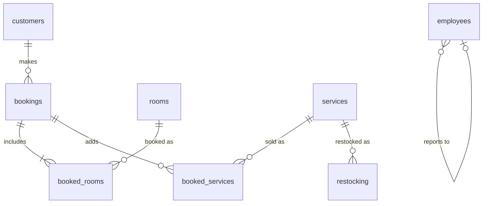

# Hotel Management System

A hotel booking and operations app. Guests search for free rooms, book several at once and get an invoice. The front desk sees who is in house, adds services such as room service or laundry to a stay, checks guests out and prints bills. The manager sees current bookings, staff salaries, daily revenue, expenses and profit.

It runs serverless on Cloudflare Workers with [Hono](https://hono.dev) and a [D1](https://developers.cloudflare.com/d1/) (SQLite) database. Pages are rendered on the server, with no client-side framework.

## Try it

The login page has one-click demo accounts for a guest, the front desk and the manager. All demo accounts use the password `demo1234`. The database resets to fresh demo data every night (03:00 UTC), so feel free to book, cancel and check out.

## Data model



`hotel_expenses` holds daily management, restocking and salary costs. Schema: [`migrations/0001_init.sql`](migrations/0001_init.sql).

- **Availability.** A room is free when no active booking overlaps the requested stay (`check_in < requested check-out` and `check_out > requested check-in`); check-out day is bookable again.
- **Revenue** for a day is one night's price for every room occupied that night plus the services sold that day. Profit is revenue minus that day's expenses.
- **Services** can only be added to bookings with guests in house today, and draw down stock, which is logged for restocking.

## Security

- Passwords are hashed with PBKDF2-SHA256 (100,000 iterations, per-user salt) using Web Crypto.
- Sessions are HMAC-signed, HTTP-only cookies.
- Every query is parameterised, and every page escapes its output.
- Guests can only open their own invoices; staff pages check the role.

## Running locally

Requires Node.js 20 or newer.

```bash
npm install
cp .dev.vars.example .dev.vars        # then set SESSION_SECRET to a long random string
npm run db:migrate                    # create the local D1 database
npm run dev                           # http://localhost:8787
```

The database fills itself with demo data on the first request. To trigger the nightly reset by hand, run the dev server with `npx wrangler dev --test-scheduled` and open `/__scheduled`.

## Deploying

```bash
npx wrangler d1 create hotel          # put the returned database_id in wrangler.jsonc
npm run db:migrate:remote
npx wrangler secret put SESSION_SECRET
npm run deploy
```

## Code layout

```
src/index.ts    Routes: guests, front desk, manager, demo sign-in, nightly reset
src/db.ts       All database queries
src/views.ts    Server-rendered pages (Bootstrap 5)
src/auth.ts     Password hashing and signed-cookie sessions
src/seed.ts     Demo data, with dates relative to today
public/         Static assets
```

## License

[MIT](LICENSE)
